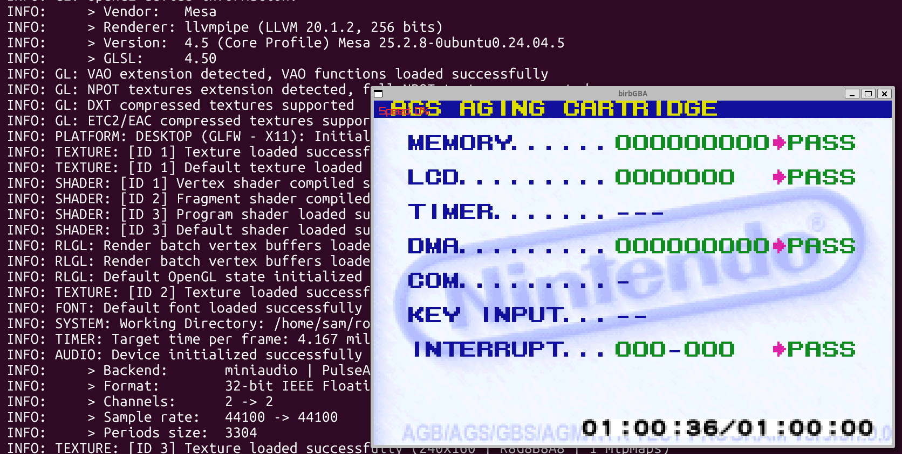

# An Early Stage GBA emulator, in ROC

## Goal
BirbGBA can now run some offcial roms without crashing, however, there is no sound. And I am not very confident on its perf in all scenes.

Hence, the next step will be add support for FLASH save, add sound, and more perf optimization.

## Controls

| GBA | Arrows (default) | WASD |
|---|---|---|
| D-pad | Arrow keys | WASD |
| A / B | X / Z | K / J |
| L / R | A / S | L / ; |
| Start / Select | Enter / Backspace | Enter / Backspace |

Alt: switch layouts · P: pause/resume · Esc: save and exit.

## Some Progress here

With the minimal RocRay frontend, birbGBA can run cult-of-GBA BIOS, EmiBIOS and the official BIOS without explicit crashing.

No sound rn though.

BirbGBA passed ArmWrestler test suites, and most of gba-tests' test roms.

## Behavior references:
- ARM DDI 0100I Architecture Reference Manual
- Nintendo Gba Manual V1.1
- [GBATEK](https://mgba-emu.github.io/gbatek/gba.html) by Martin Korth, author of NoCashGBA
- [mGBA](https://github.com/mgba-emu/mgba)
- [NanoBoyAdvance](https://codeberg.org/nba-emu/NanoBoyAdvance)
- [Cult-of-GBA BIOS](https://github.com/Cult-of-GBA/BIOS)
- [EmiBIOS](https://github.com/coolbho3k/emibios)
- [ArmWrestler](https://github.com/destoer/armwrestler-gba-fixed)
- [gba-tests](https://github.com/jsmolka/gba-tests)
- EmuDev & GBADev Discord
- Many more tech blogs, will write them in later

## License

birbGBA is free software, licensed under the GNU General Public License,
version 3 or (at your option) any later version (**GPL-3.0-or-later**).
See [LICENSE](LICENSE) for the full terms.

Third-party dependencies and reference materials retain their respective licenses.
