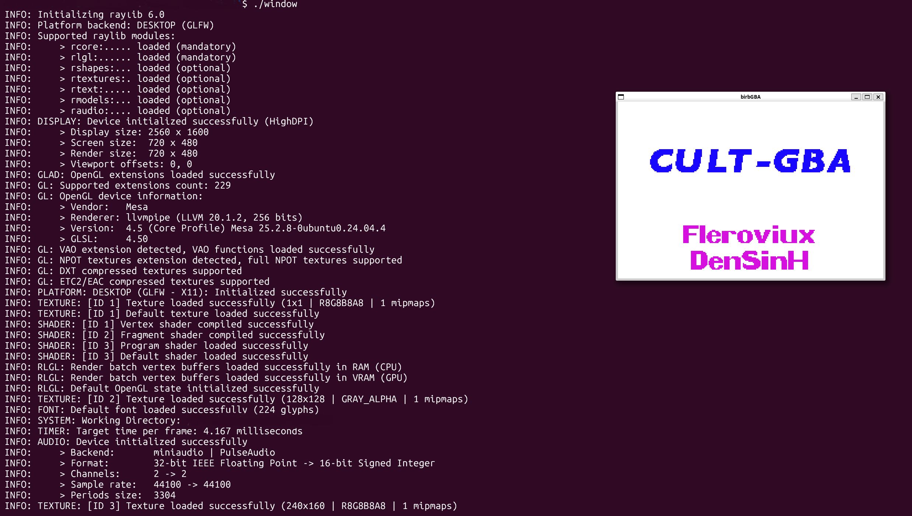

# An Early Stage GBA emulator, in ROC

## Goal
Rn it will just being able to run some offical ROMs, without crashing during playthrough of course.

## Some Progress here

With the minimal RocRay frontend, birbGBA can run this bios now.
No sound/input supported rn though.

## Behavior references:
- ARM DDI 0100I Architecture Reference Manual
- Nintendo Gba Manual V1.1
- [GBATEK](https://mgba-emu.github.io/gbatek/gba.html) by Martin Korth, author of NoCashGBA
- [mGBA](https://github.com/mgba-emu/mgba)
- [NanoBoyAdvance](https://codeberg.org/nba-emu/NanoBoyAdvance)
- [Cult-of-GBA BIOS](https://github.com/Cult-of-GBA/BIOS)
- Many more tech blogs, will write them in later

## License

birbGBA is free software, licensed under the GNU General Public License,
version 3 or (at your option) any later version (**GPL-3.0-or-later**).
See [LICENSE](LICENSE) for the full terms.

Third-party dependencies and reference materials retain their respective licenses.
